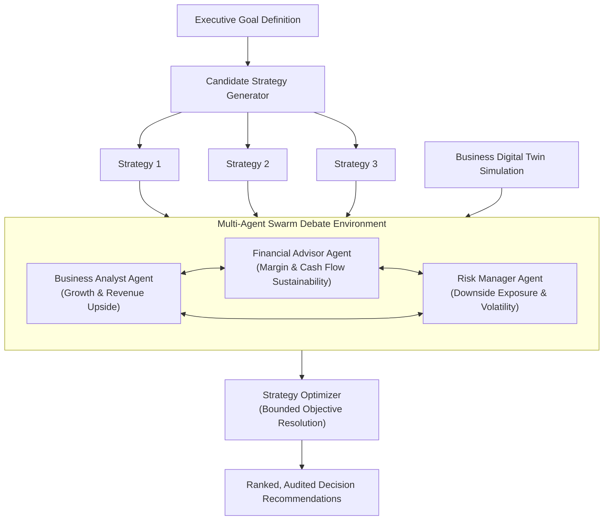
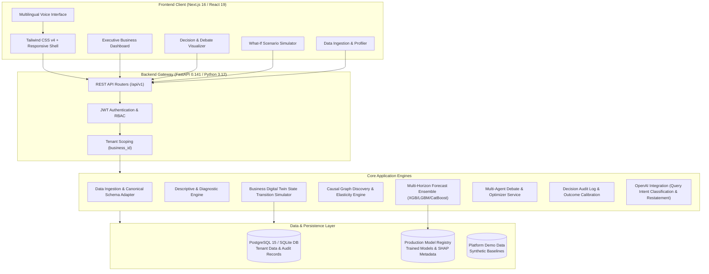

<div align="center">

# DecisionGPT
### Goal-Driven Multi-Agent Enterprise Decision Support Platform

[](https://fastapi.tiangolo.com)
[](https://nextjs.org/)
[](https://react.dev/)
[](https://www.python.org/)
[](https://www.typescriptlang.org/)
[](https://tailwindcss.com/)
[](frontend/)
[](LICENSE)

*An autonomous, explainable decision-support and scenario-simulation platform that connects business goals, predictive analytics, causal reasoning, what-if digital twin simulations, and collaborative multi-agent debate to transform fragmented enterprise data into audited, actionable decisions.*

[Explore Features](#key-features) • [System Architecture](#system-architecture) • [Quickstart Guide](#quickstart-guide) • [Demo Credentials](#demo-user-accounts) • [API Documentation](#api-and-developer-documentation)

---

</div>

## Table of Contents

- [1. Platform Overview](#1-platform-overview)
- [2. The Business Problem](#2-the-business-problem)
- [3. Key Features](#3-key-features)
- [4. Multi-Agent Intelligence System](#4-multi-agent-intelligence-system)
- [5. System Architecture](#5-system-architecture)
- [6. Application Workflows](#6-application-workflows)
- [7. Technology Stack](#7-technology-stack)
- [8. Repository Structure](#8-repository-structure)
- [9. Quickstart Guide](#9-quickstart-guide)
- [10. Demo User Accounts](#10-demo-user-accounts)
- [11. Environment Configuration](#11-environment-configuration)
- [12. Database Setup & Migrations](#12-database-setup--migrations)
- [13. Running the Application](#13-running-the-application)
- [14. Testing & Quality Assurance](#14-testing--quality-assurance)
- [15. API and Developer Documentation](#15-api-and-developer-documentation)
- [16. Security, Privacy & Data Isolation](#16-security-privacy--data-isolation)
- [17. Contributing & Development](#17-contributing--development)
- [18. License](#18-license)

---

## 1. Platform Overview

**DecisionGPT** is an enterprise-grade decision intelligence platform tailored for business owners, enterprise managers, financial directors, and operational leaders. Traditional analytics tools present descriptive backward-looking dashboards or opaque black-box forecasts without actionable guidance. DecisionGPT closes this gap through an end-to-end decision lifecycle:

```
[Business Goal] ➔ [Data Preprocessing] ➔ [Multi-Horizon Forecasts] ➔ [Causal Graph Discovery]
       ➔ [Digital Twin Simulation] ➔ [Multi-Agent Swarm Debate] ➔ [Audited Recommendation]
       ➔ [Human Decision Approval] ➔ [Real-World Outcome Tracking & Model Recalibration]
```

### Core Value Proposition

- **Goal-Centric Strategy**: Transforms high-level business objectives (e.g., *"Increase operating margin by 12% over 60 days without reducing customer retention"*) into concrete parameter interventions across pricing, marketing, and inventory.
- **Strict Analytical Integrity**: Business metrics, forecasts, and risk scores are computed deterministically by verified machine learning models and dynamic state engines. Large Language Models (LLMs) are restricted strictly to query intent classification and natural language explanation—they **never** generate, interpolate, or modify business numbers.
- **Risk-Aware Simulation**: Stress-tests potential interventions in a digital twin simulation against cash balance constraints, inventory stockouts, customer churn elasticities, and competitor benchmarks prior to real-world deployment.
- **Multi-Perspective Agent Debate**: Simulates executive consensus through specialized role agents (Strategy, Finance, Operations, Risk) that iteratively critique, penalize, and refine proposed plans until a bounded consensus is reached.

---

## 2. The Business Problem

Modern small-to-medium enterprises (SMEs) and growing businesses face three fundamental operational barriers:

1. **Fragmented, Descriptive Analytics**: Disconnected spreadsheets and point-of-sale systems show what happened in the past, but fail to explain *why* it happened or *what to do next*.
2. **Predictive Without Prescriptive**: Conventional forecasting packages predict sales or churn in isolation, but provide no mechanism to model trade-offs (e.g., how raising price affects retention, stock turnover, and cash runway simultaneously).
3. **The AI Hallucination Hazard**: Generic generative AI and monolithic LLMs lack underlying financial constraints, frequently inventing phantom KPI figures, ignoring balance sheet conservation laws, and providing risky, uncalibrated business advice.

DecisionGPT eliminates these issues by replacing speculative generative prose with an auditable mathematical pipeline: **Causal Discovery + Digital Twin Simulation + Multi-Agent Consensus Scoring**.

---

## 3. Key Features

### 1. Guided Data Preprocessing & Profiling
- **Automated Ingestion**: Ingests multi-table transactional records (sales orders, customer cohorts, marketing campaigns, inventory logs, balance sheets) from CSV and Parquet formats.
- **Intelligent Schema Mapping**: Deterministic column identification, date-order validation, type casting, missing value imputation, and anomaly filtering.
- **Data Quality Reporting**: Generates instant tenant-isolated profiling reports detailing row validity, rejected records, outlier bounds, and canonical type assignments.

### 2. Multi-Horizon Predictive Analytics
- **Forecasting Horizons**: Generates calibrated demand and revenue trajectories across 7-day, 14-day, 28-day, and 90-day planning horizons.
- **Ensemble ML Pipeline**: Deploys a model registry including Gradient Boosted Trees (XGBoost, LightGBM, CatBoost), Ridge/Lasso regressions, and baseline time-series models.
- **Conformal Prediction Bounds**: Equips every point prediction with calibrated lower and upper prediction intervals, reporting data sufficiency warnings when historical variance is elevated.

### 3. Customer Churn & Retention Analytics
- **Cohort Risk Scoring**: Calculates probability of customer lapse using calibrated classifier ensembles.
- **Feature Importance & Explanations**: Computes SHAP (SHapley Additive exPlanations) values to identify exact churn drivers (recency, purchase frequency, average order value, discount dependency).
- **Proactive Intervention Triggers**: Recommends personalized re-engagement and retention strategies before customer lapse occurs.

### 4. Causal Discovery & Structural Equations
- **Empirical Edge Detection**: Learns directed dependency graphs using constraint-based causal discovery and Granger causality to isolate true drivers from spurious correlations.
- **Counterfactual Reasoning**: Accurately computes price and marketing elasticity curves without assuming constant linear relationships.

### 5. Business Digital Twin Simulation
- **State Transition Engine**: Models the business balance sheet, income statement, working capital, inventory holding costs, and customer pool dynamically over future timesteps.
- **Constraint Enforcement**: Enforces hard balance sheet invariants (e.g., cash cannot drop below minimum payroll reserve; stockout prevents sales fulfillment).
- **Scenario Stress-Testing**: Allows executives to simulate "What-If" scenarios (e.g., supply chain cost increases, price hikes, ad spend cuts) with instant feedback.

### 6. Closed-Loop Decision Governance & Outcome Tracking
- **Interactive Decision Cards**: Presents recommended actions alongside transparent rationale, trade-off analysis, expected upside, and worst-case risk projections.
- **Human-in-the-Loop Override**: Decision-makers can accept, reject, or modify proposed strategies; all changes are versioned and logged.
- **Empirical Outcome Validation**: Tracks real-world post-decision performance against the forecasted expectation window, triggering model drift alerts and automatic recalibrations when variance exceeds acceptable thresholds.

### 7. Multilingual Voice Accessibility
- **Hands-Free Business Intelligence**: Integrated speech-to-text and text-to-speech engine powered by the browser Web Speech API.
- **Regional Language Support**: Full interactive voice and transcription support across English and 8 Indian regional languages: Hindi (`hi-IN`), Tamil (`ta-IN`), Telugu (`te-IN`), Kannada (`kn-IN`), Malayalam (`ml-IN`), Marathi (`mr-IN`), Bengali (`bn-IN`), and Gujarati (`gu-IN`).

---

## 4. Multi-Agent Intelligence System

DecisionGPT models strategic planning through a team of specialized analytical agents working in concert. Rather than relying on a single monolithic prompt, each agent maintains an explicit analytical mandate and objective function:



### Specialist Agent Mandates

| Agent | Core Objective | Evaluation Focus | Key Metrics Analyzed |
|---|---|---|---|
| **Business Analyst** | Revenue Expansion & Growth | Market opportunity, demand velocity, customer acquisition | Gross Revenue, Unit Sales Volume, Target Attainment |
| **Financial Advisor** | Financial Health & Liquidity | Margin protection, capital efficiency, working capital | Operating Margin, Net Profit, Free Cash Flow, Holding Costs |
| **Risk Manager** | Capital Preservation & Stability | Downside scenario modeling, cash reserves, churn volatility | Value at Risk (VaR), Stockout Probability, Churn Escalation |
| **Strategy Optimizer** | Multi-Objective Arbitration | Synthesizes agent evaluations, resolves trade-offs, eliminates unviable candidates | Composite Score, Pareto Efficiency, Constraint Compliance |

### Deterministic Consensus Formula

The Strategy Optimizer evaluates each candidate strategy $s$ across simulation horizon $H$ using the calibrated multi-agent scoring function:

$$\text{Score}(s) = w_{\text{profit}} \cdot \hat{U}_{\text{profit}}(s) + w_{\text{goal}} \cdot \hat{U}_{\text{goal}}(s) - w_{\text{risk}} \cdot \text{RiskPenalty}(s) - \text{ConstraintPenalty}(s)$$

Where:
- $\hat{U}_{\text{profit}}(s)$ is the normalized projected profit improvement over baseline from the Digital Twin.
- $\hat{U}_{\text{goal}}(s)$ is the calculated probability of achieving the specific target set in the user's business goal.
- $\text{RiskPenalty}(s)$ is the downside penalty computed from the Risk Manager's evaluation (cash volatility and inventory stress).
- $\text{ConstraintPenalty}(s)$ applies an immediate disqualification penalty if any business boundary (e.g. minimum cash reserves or non-negative inventory) is violated.

---

## 5. System Architecture

DecisionGPT follows a modern, decoupled microservices architecture designed for enterprise scalability, security, and reproducibility:



### Strict LLM Boundary Policy

To maintain enterprise research and operational integrity:
- **No Hallucinated Numbers**: The LLM is never permitted to generate KPI values, calculate revenue, invent churn probabilities, or modify simulation outcomes.
- **Intent Parsing Only**: The LLM parses incoming natural language queries into strict JSON-schema filter objects (operation, metric, horizon, dimension).
- **Deterministic Verification**: Plain-language narrative summaries are validated by deterministic guardrails to ensure no numbers exist in the text that were not pre-calculated and verified by the backend analytics engine.

---

## 6. Application Workflows

### 1. Data Ingestion & Preprocessing
```
Upload CSV/Parquet ➔ Column Identification ➔ Type Inference ➔ Integrity Audit ➔ Canonical Database Table
```
The ingestion engine normalizes arbitrary business exports into canonical data structures (`sales`, `products`, `customers`, `inventory`, `marketing`, `financials`) while isolating invalid rows into an audit log.

### 2. Multi-Horizon Predictive Analysis
```
Select Horizon (7/14/28/90d) ➔ Feature Engineering ➔ Model Ensemble Inference ➔ Conformal Prediction Intervals
```
The platform runs scheduled and on-demand model inference, displaying projected revenue, order volume, and customer retention alongside historical trends.

### 3. Closed-Loop Strategic Decision Flow
```
User Goal ➔ Candidate Generation ➔ Digital Twin Simulation ➔ Multi-Agent Debate ➔ Human Approval ➔ Outcome Tracking
```
Executives select or input an organizational objective. The system simulates candidate strategies through the digital twin, conducts multi-agent debate, presents the optimal plan with confidence intervals, and records real-world results against predictions to monitor variance.

---

## 7. Technology Stack

### Frontend Application
| Technology | Version | Purpose |
|---|---|---|
| **Next.js** | `16.4.2` | React framework with App Router, SSR, and API proxying |
| **React** | `19.2.8` | Component architecture and state management |
| **TypeScript** | `5.x` | Static typing and interface contracts |
| **Tailwind CSS** | `4.x` | Modern styling and responsive enterprise design system |
| **Recharts** | `3.10.1` | Business analytics charting and time-series visualization |
| **Three.js** | `0.186.1` | Interactive visual effects and landing page graphics |
| **Vitest** | `3.0.5` | High-performance unit and component test suite |
| **Testing Library** | `16.1.0` | User-centric DOM testing and accessibility verification |

### Backend API & Core Services
| Technology | Version | Purpose |
|---|---|---|
| **FastAPI** | `0.141.1` | High-performance asynchronous REST API framework |
| **Python** | `3.12` | Core backend programming language |
| **SQLAlchemy** | `2.0.35` | Object-Relational Mapping (ORM) and database query engine |
| **Alembic** | `1.14.x` | Relational database schema migrations |
| **Pydantic** | `2.13.4` | Data validation, schema parsing, and settings management |
| **Uvicorn** | `0.34.x` | ASGI production web server |
| **Pytest** | `9.1.1` | Comprehensive backend test runner |

### Machine Learning, Analytics & Simulation
| Technology | Version | Purpose |
|---|---|---|
| **scikit-learn** | `1.9.0` | Classification, regression, and preprocessing pipelines |
| **XGBoost** | `3.4.0` | Gradient-boosted decision trees for sales forecasting |
| **LightGBM** | `4.7.0` | High-speed gradient boosting for multi-series demand |
| **CatBoost** | `1.2.10` | Categorical feature handling and churn prediction |
| **statsmodels** | `0.15.0` | Econometric time-series analysis and ARIMA baselines |
| **NetworkX** | `3.7` | Causal dependency graph construction and analysis |
| **SciPy & NumPy** | Latest | Scientific computing, optimization, and linear algebra |
| **Pandas** | `3.0.5` | High-performance data manipulation and aggregation |
| **OpenAI SDK** | Latest | Official API for natural language intent parsing (Optional) |

---

## 8. Repository Structure

```
.
├── backend/                        # FastAPI Backend Application
│   ├── alembic/                    # Database schema migration versions
│   ├── app/
│   │   ├── api/v1/                 # REST API endpoints (auth, analytics, decisions, etc.)
│   │   ├── core/                   # Security, configuration, and logging
│   │   ├── db/                     # SQLAlchemy models and session management
│   │   ├── models/                 # ORM entities (User, Business, Goal, Decision, etc.)
│   │   ├── schemas/                # Pydantic request/response schemas
│   │   └── services/               # Core services (forecasting, causal, twin, debate)
│   ├── scripts/                    # Backend bootstrap and seeding scripts
│   ├── Dockerfile                  # Production container definition
│   └── requirements.txt            # Python dependencies
│
├── frontend/                       # Next.js 16 Frontend Application
│   ├── public/                     # Static assets, icons, and SVG graphics
│   ├── src/
│   │   ├── app/                    # Next.js App Router pages and routes
│   │   │   ├── analytics/          # Business intelligence and KPI charts
│   │   │   ├── chat/               # Natural language analytics assistant
│   │   │   ├── customers/          # Customer churn and cohort analysis
│   │   │   ├── data/               # Guided CSV/Parquet data upload
│   │   │   ├── decisions/          # Multi-agent decision hub and debate viewer
│   │   │   ├── forecast/           # Multi-horizon forecasting visualizer
│   │   │   ├── outcomes/           # Outcome tracking and model drift monitoring
│   │   │   ├── simulation/         # What-If scenario digital twin
│   │   │   └── login/              # Authentication and account access
│   │   ├── components/             # Reusable UI components, modals, and charts
│   │   └── lib/                    # API client, session management, and utilities
│   ├── package.json                # Node dependencies and scripts
│   └── vitest.config.ts            # Frontend test configuration
│
├── ml/                             # Machine Learning & Causal Modules
│   ├── causal/                     # Causal discovery and structural equation models
│   ├── evaluation/                 # Model validation metrics (MAE, RMSE, WAPE, etc.)
│   ├── features/                   # Time-series feature engineering and store
│   └── preprocessing/              # Adapters and canonical schema transformations
│
├── models/                         # Model Registry & Trained Estimators
│   ├── churn_random_forest/        # Churn classifier artifacts
│   ├── sales_forecast_xgboost/     # Sales forecast artifacts
│   └── registry_index.jsonl        # Model registry index
│
├── data/                           # Platform Starter Datasets
│   ├── platform/                   # Deterministic synthetic starter data
│   └── README.md                   # Data isolation and architecture guidelines
│
├── deploy/                         # Production & Staging Deployment
│   ├── docker-compose.yml          # Multi-container orchestration (App + Postgres)
│   └── postgres/                   # Database init scripts and roles
│
├── docs/                           # Technical Specifications & Documentation
│   ├── API_SPECIFICATION.md        # Comprehensive REST API contracts
│   ├── BACKEND_SPECIFICATION.md    # Backend architectural specifications
│   ├── FRONTEND_SPECIFICATION.md   # Frontend UI/UX specifications
│   ├── MULTI_AGENT_SPECIFICATION.md# Multi-agent swarm debate protocols
│   ├── DIGITAL_TWIN_SPECIFICATION.md# Digital twin simulation formulas
│   ├── CAUSAL_GRAPH_SPECIFICATION.md# Causal discovery protocols
│   ├── DATABASE_SCHEMA.md          # Relational database entity diagrams
│   └── DEPLOYMENT.md               # Production deployment handbook
│
├── scripts/                        # Repository Maintenance & Diagnostic Tools
│   ├── audit_e2e.py                # End-to-end integration and API verification
│   ├── check_env.py                # Python environment and package validator
│   ├── generate_platform_data.py   # Platform demo dataset generator
│   ├── seed_demo_accounts.py       # Seeds Admin, Researcher, and SME demo users
│   └── verify_rbac.py              # Role-Based Access Control test suite
│
├── tests/                          # Automated Pytest Test Suite
│   ├── api/                        # API route and status code tests
│   ├── integration/                # Service interaction and database tests
│   └── unit/                       # Component unit tests
│
├── .env.example                    # Environment configuration template
├── docker-compose.yml              # Local container configuration
├── pytest.ini                      # Pytest runner configuration
└── LICENSE                         # Project license
```

---

## 9. Quickstart Guide

Follow these steps to configure and run the complete DecisionGPT application locally.

### Prerequisites

Ensure the following tools are installed on your workstation:
- **Python**: Version `3.12` or higher ([Download Python](https://www.python.org/downloads/))
- **Node.js**: Version `20.x` or higher with `npm 10+` ([Download Node.js](https://nodejs.org/))
- **Git**: Version `2.x` or higher ([Download Git](https://git-scm.com/))
- *(Optional)* **Docker & Docker Compose**: For containerized PostgreSQL deployment.

---

## 10. Demo User Accounts

The application includes three pre-configured demonstration accounts representing distinct institutional roles. Run the seed script to initialize them:

```bash
python scripts/seed_demo_accounts.py
```

| Role | Email / Username | Password | Permissions & Workspace |
|---|---|---|---|
| **System Admin** | `admin@decisiongpt.local` | `AdminPass@2026!` | Full administrative access, tenant management, system diagnostics, and research console |
| **Platform Researcher** | `researcher@decisiongpt.local` | `ResearchPass@2026!` | Model performance analytics, benchmark comparisons, and evaluation datasets |
| **SME Business User** | `demo@decisiongpt.local` | `DemoUser@2026!` | SME Business OS workspace, goal planner, decision hub, digital twin simulations, 180 days seeded business data |

---

## 11. Environment Configuration

### Root Environment (`.env`)

Copy the provided root template:
```bash
cp .env.example .env
```

Key environment settings:
```ini
ENVIRONMENT=development
LOG_LEVEL=INFO
SECRET_KEY=change-me-in-production-random-secret
DATABASE_URL=sqlite:///./dev.db
NEXT_PUBLIC_API_BASE_URL=http://localhost:8000/api/v1
AUTH_ENABLED=true
JWT_SECRET=change-me-jwt-secret-random-hex-string
JWT_TTL_SECONDS=43200

# Optional: OpenAI API for natural language analytics chat
# Leave blank to operate entirely in deterministic rule-based mode
OPENAI_API_KEY=
OPENAI_MODEL=gpt-4.1-mini
```

### Frontend Environment (`frontend/.env.local`)

Copy the frontend template:
```bash
cp frontend/.env.example frontend/.env.local
```

```ini
NEXT_PUBLIC_API_BASE_URL=http://localhost:8000/api/v1
```

---

## 12. Database Setup & Migrations

### Local Development (SQLite)

For rapid local testing, SQLite is supported out of the box with zero external database installation required. Initializing the demo accounts automatically builds the database schema and seeds 180 days of realistic business transactions:

```bash
python scripts/seed_demo_accounts.py
```

### Production / Staging (PostgreSQL 15)

For multi-tenant production deployments:

1. Launch PostgreSQL container:
   ```bash
   docker compose up -d postgres
   ```
2. Execute schema migrations via Alembic:
   ```bash
   cd backend
   alembic upgrade head
   cd ..
   ```

---

## 13. Running the Application

### Option A: Local Development Mode

Start both backend and frontend services in separate terminal windows:

#### Terminal 1 — Backend API (FastAPI)
```bash
# Navigate to backend directory
cd backend

# Create and activate Python virtual environment
python -m venv .venv
source .venv/bin/activate       # On Linux/macOS
# or: .venv\Scripts\activate   # On Windows PowerShell

# Install backend dependencies
pip install -r requirements.txt

# Start FastAPI server on port 8000
python -m uvicorn app.main:app --reload --host 0.0.0.0 --port 8000
```
Backend API will be running at: `http://localhost:8000`  
Interactive OpenAPI / Swagger Docs: `http://localhost:8000/docs`

#### Terminal 2 — Frontend Application (Next.js)
```bash
# Navigate to frontend directory
cd frontend

# Install Node dependencies
npm install

# Start Next.js development server on port 3000
npm run dev
```
Frontend Web Application will be running at: `http://localhost:3000`

---

### Option B: Docker Compose Deployment

Run the complete stack (PostgreSQL + FastAPI Backend + Next.js Frontend) in unified containers:

```bash
docker compose up --build
```

---

## 14. Testing & Quality Assurance

DecisionGPT maintains extensive test coverage across both frontend and backend layers to ensure software reliability and mathematical reproducibility.

### Running Frontend Tests (Vitest)

The frontend includes 247 automated unit and integration tests verifying component rendering, user interactions, voice accessibility, and API state handling:

```bash
cd frontend
npm test
```

Expected output:
```
Test Files  34 passed (34)
Tests       247 passed (247)
Duration    ~35s
```

### Running Backend Tests (Pytest)

Run the full Python test suite spanning unit tests, API integration tests, and security boundary assertions:

```bash
pytest tests/unit tests/integration
```

### Running the End-to-End System Audit

Execute the complete end-to-end audit verifying authentication, data ingestion, forecasting, digital twin simulations, multi-agent debate, and RBAC security:

```bash
python scripts/audit_e2e.py
```

Expected output:
```
======================================================================
SME END-TO-END FLOW
  [OK] 1. auth: registered + /me
  [OK] 2. business created
  [OK] 3. data uploaded
  [OK] 4. analytics & forecasting validated
  [OK] 5. digital twin simulation validated
  [OK] 6. multi-agent debate validated
======================================================================
ACCESS CONTROL (auth_enabled=True)
  [OK] cross-business access blocked: 404
  [OK] SME blocked from admin routes: 403
  [OK] admin allowed into research: 200
======================================================================
AUDIT COMPLETE — no assertion failures.
```

---

## 15. API and Developer Documentation

DecisionGPT exposes an OpenAPI 3.1-compliant REST API. Once the backend server is running, visit `http://localhost:8000/docs` for the interactive Swagger documentation.

### Core API Endpoints Overview

| Resource | Method | Path | Description | Access Role |
|---|---|---|---|---|
| **Authentication** | `POST` | `/api/v1/auth/register` | Register new SME user account | Public |
| | `POST` | `/api/v1/auth/login` | Authenticate and obtain JWT bearer token | Public |
| | `GET` | `/api/v1/auth/me` | Retrieve profile of authenticated user | Authenticated |
| **Business Management** | `GET` | `/api/v1/businesses` | List businesses owned by user | SME / Admin |
| | `POST` | `/api/v1/businesses` | Create and register a new enterprise entity | SME / Admin |
| **Data Ingestion** | `POST` | `/api/v1/businesses/{id}/data/upload` | Upload CSV/Parquet records for canonical parsing | SME Owner |
| | `GET` | `/api/v1/businesses/{id}/data/profile` | Ingestion quality and column health summary | SME Owner |
| **Analytics & KPIs** | `GET` | `/api/v1/businesses/{id}/analytics/kpis` | Summary business KPIs (Revenue, Margin, Volume) | SME Owner |
| | `POST` | `/api/v1/businesses/{id}/analytics/query` | Natural language question intent resolution | SME Owner |
| **Forecasting** | `POST` | `/api/v1/businesses/{id}/analytics/forecast` | Generate multi-horizon demand/revenue forecast | SME Owner |
| **Digital Twin** | `POST` | `/api/v1/businesses/{id}/digital-twin/simulate` | Execute state transition simulation for a strategy | SME Owner |
| **Multi-Agent Debate** | `POST` | `/api/v1/businesses/{id}/goals/{goal_id}/solve` | Launch multi-agent debate and optimization | SME Owner |
| **Decision Tracking** | `POST` | `/api/v1/businesses/{id}/decisions/{id}/respond` | Accept, modify, or reject a recommendation | SME Owner |
| | `GET` | `/api/v1/businesses/{id}/decisions/outcomes` | Compare forecasted expectations to real outcomes | SME Owner |

For comprehensive schema definitions and request payloads, consult [docs/API_SPECIFICATION.md](docs/API_SPECIFICATION.md).

---

## 16. Security, Privacy & Data Isolation

DecisionGPT is designed from the ground up for strict multi-tenant enterprise data privacy:

- **Tenant Isolation**: Every database query is strictly filtered by the authenticated user's `business_id`. Cross-tenant requests return `404 Not Found` rather than exposing metadata.
- **Role-Based Access Control (RBAC)**: Distinct permission boundaries separate standard SME business operators from system administrators and platform researchers.
- **Cryptographic Security**: Passwords hashed using Argon2/PBKDF2 algorithms. JWT sessions support configurable TTL, cryptographic signing, and immediate token revocation upon logout.
- **Offline & Private AI Fallback**: If an enterprise chooses not to configure an external OpenAI API key, DecisionGPT operates 100% locally in deterministic rule-based mode with zero network calls.

---

## 17. Contributing & Development

We welcome contributions from software engineers, data scientists, and UI/UX designers!

1. Fork the repository and create a feature branch (`git checkout -b feature/amazing-feature`).
2. Adhere to TypeScript and Python style guides (`eslint` for frontend, `ruff`/`flake8` for backend).
3. Ensure all tests pass before opening a pull request (`npm test` and `pytest`).
4. Submit your pull request with a descriptive summary of your changes.

---

## 18. License

This project is licensed under the terms of the **MIT License**. See the [LICENSE](LICENSE) file for details.

---

<div align="center">
  <sub>Built with enterprise rigor for data-driven business leaders.</sub>
</div>
